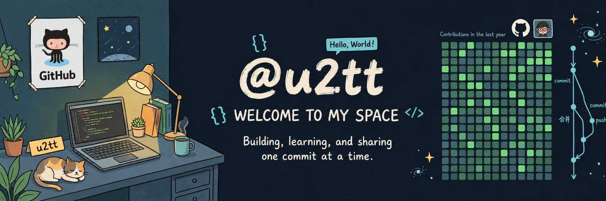

 

## 关于我

生物科学在读，玩电脑比做实验的时间长。

- **日常** —— macOS主力系统，游戏本配置arch使用
- **项目记录** —— 日常工作和项目记录[博客](https://u2tt.github.io)

## 技术栈

<picture>
  <source media="(prefers-color-scheme: dark)" srcset="https://skillicons.dev/icons?i=py%2Clinux%2Carch%2Capple%2Cdocker%2Cgithub%2Cvscode%2Cblender&theme=dark&perline=8">
  <source media="(prefers-color-scheme: light)" srcset="https://skillicons.dev/icons?i=py%2Clinux%2Carch%2Capple%2Cdocker%2Cgithub%2Cvscode%2Cblender&theme=light&perline=8">
  
</picture>

## 项目

| 项目 | 描述 | 技术栈 |
|:---|:---|:---|
| **[RP2040 Mini TXT Reader](https://github.com/u2tt/rp2040-txt-reader)** | 嵌入式工程尝试 | CircuitPython · RP2040 · SPI · ST7735 |
| **[u2tt.github.io](https://u2tt.github.io)** | 个人博客，随便写的东西 | Hexo · GitHub Pages |
| **[Lumina](https://github.com/u2tt/Lumina)** | 把**本地视频**当作 macOS 桌面壁纸。 | Switch · Shell |